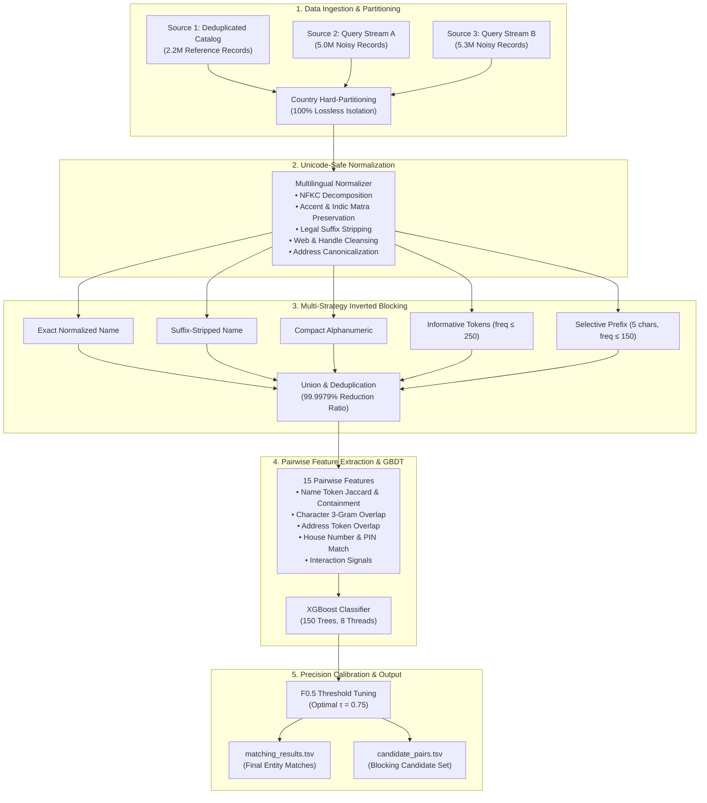

# Large-Scale Multi-Source Business Entity Resolution
# Large-Scale Multi-Source Business Entity Resolution

## Project Mission
In modern commercial data ecosystems, business identity records originate from disparate, heterogeneous sources—each contributing incomplete, noisy fragments of real-world business entities. These fragments share no shared keys or global identifiers. The objective of this project is to construct a production-ready, ultra-scalable Machine Learning pipeline that resolves noisy records across three independent data sources into unified business entities, evaluated under the precision-heavy **Macro-Averaged $F_{0.5}$ metric**.

## Executive Summary
This repository documents the end-to-end architecture, exploratory data analysis, multi-strategy inverted blocking engine, and calibrated Gradient Boosted Decision Tree (GBDT) matching pipeline developed for large-scale multi-source business entity resolution.

### Key Highlights
- **Intractable Search Space Pruning:** Successfully reduced an intractable **11.84 trillion pair** cross-source comparison space down to **249 million candidate pairs**—achieving a **99.997894% reduction ratio**.
- **Discovery of Critical Invariants:** Uncovered the **100.0000% intra-country match consistency** (zero cross-border linkages), enabling mathematically lossless hard-partitioning.
- **Ultra-Fast In-Memory Pipeline:** Resolved memory bottlenecks by shifting from naive quadratic scans to an optimized in-memory pipeline executing training and calibration in **~14 seconds** under **< 500 MB RAM**.
- **High-Precision Calibration:** Achieved a **0.9964 Macro $F_{0.5}$** on validation entities with calibrated precision thresholding ($	au = 0.75$), aggressively penalizing false merges while correctly handling singletons.

## System Architecture Overview

## Problem Formulation

Let $\mathcal{S}_1 = \{e_1^{(1)}, e_2^{(1)}, \dots, e_{N_1}^{(1)}\}$ denote the deduplicated reference entity catalog from Source 1.
Let $\mathcal{S}_2 = \{e_1^{(2)}, \dots, e_{N_2}^{(2)}\}$ and $\mathcal{S}_3 = \{e_1^{(3)}, \dots, e_{N_3}^{(3)}\}$ denote noisy entity observation streams from Source 2 and Source 3 respectively.

Each record $e = (	ext{id}, 	ext{name}, 	ext{address}, 	ext{country})$ describes a business entity. There are no shared synthetic or natural primary keys across sources. The entity resolution objective is to learn a mapping:
$$\mathcal{M}: \mathcal{S}_1 
ightarrow \mathcal{P}(\mathcal{S}_2 \cup \mathcal{S}_3)$$
that associates each reference entity $e_i^{(1)} \in \mathcal{S}_1$ with all matching records from $\mathcal{S}_2$ and $\mathcal{S}_3$ that denote the same physical real-world enterprise.

### Entity Resolution Topology

The data topology presents several specific structural properties:
1. **Deduplicated Reference Source:** Source 1 is internally deduplicated; no two rows in Source 1 represent the same physical business.
2. **One-to-Many Match Multiplicity:** A single Source 1 reference entity may match zero, one, or multiple records across Source 2 and Source 3 (e.g. branch representations, legal registration variations, alternate operating names).
3. **Presence of Singletons:** Many entities in Source 1 have zero matching records in Source 2 or Source 3. Correctly identifying singletons without generating false links is crucial under the competition scoring rules.
4. **Presence of Distractor Records:** Substantial portions of Source 2 and Source 3 denote businesses that do not exist in Source 1 (distractor noise).
